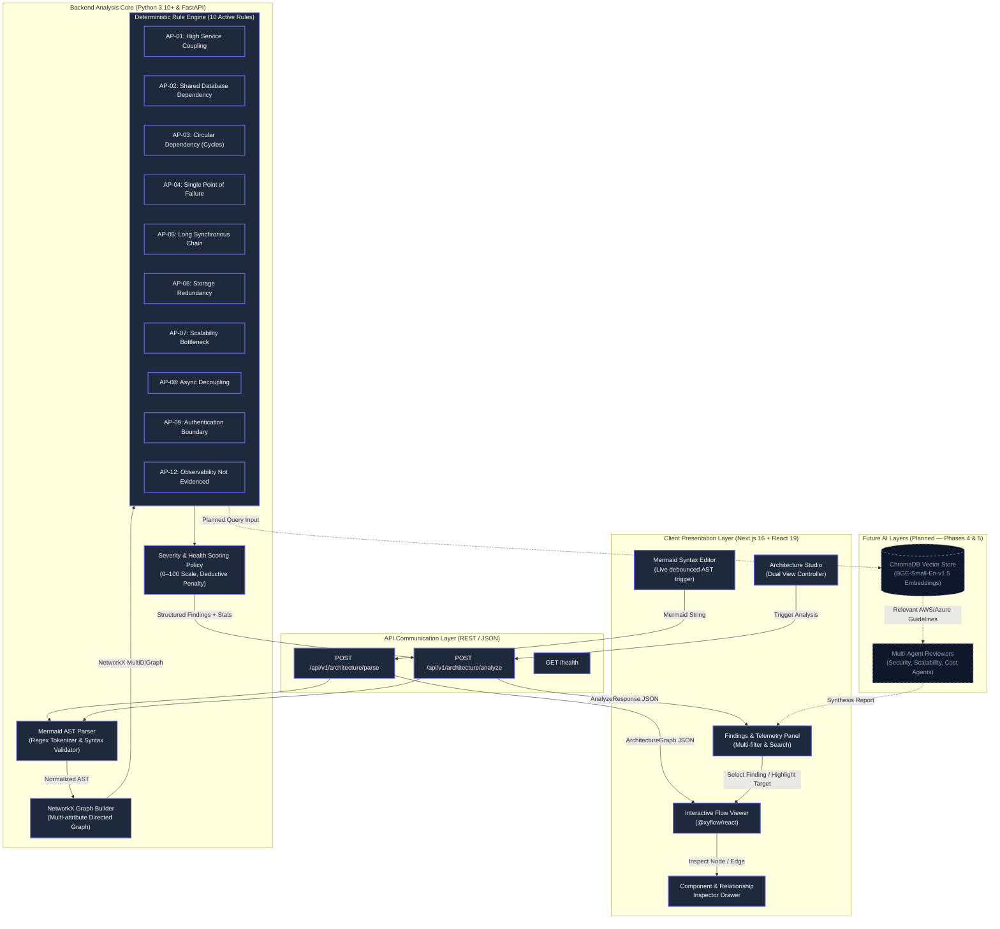
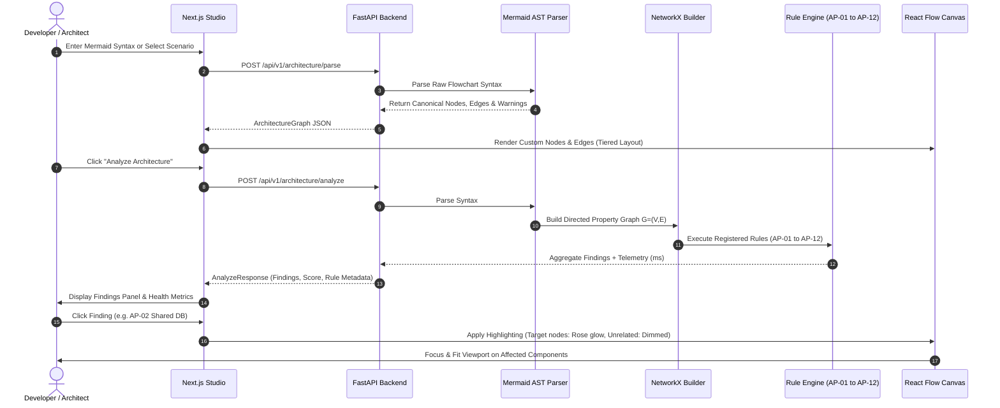

# ArchLens — System Architecture & Technical Design

**Project Title:** ArchLens — AI-Assisted Cloud-Native Microservices Architecture Reviewer  
**Institution:** University of Chakwal — Department of Computer Science (FYP)  
**Document Version:** 1.0.0  
**Status:** Implemented (Phases 1–3) & Planned Roadmap (Phases 4–5)  

---

## 1. High-Level Architectural Overview

ArchLens is a design-time architectural review and decision-support platform for distributed microservices topologies. It allows software architects, engineering teams, and students to submit high-level architecture diagrams (Mermaid flowchart syntax or structured JSON), transforms them into a mathematical property graph, evaluates them against a suite of deterministic anti-pattern rules, and visualizes the results on an interactive graph canvas.



---

## 2. Frontend Architecture (Next.js 16 App Router)

The frontend is built using **Next.js 16** with React 19, TypeScript, and Tailwind CSS. It communicates strictly with the backend over stateless HTTP REST APIs.

### 2.1 Component Hierarchy
```text
frontend/src/
├── app/
│   ├── layout.tsx                # Root layout with Geist fonts and dark-mode tokens
│   ├── globals.css               # Tailwind v4 theme + @xyflow/react canvas styles
│   └── page.tsx                  # Main SaaS workspace: Dashboard, Studio, History
├── components/
│   ├── flow/                     # Interactive React Flow visualization subsystem
│   │   ├── ArchitectureGraphViewer.tsx # Main canvas with minimap, controls, and toolbar
│   │   ├── CustomArchitectureNode.tsx  # Custom node card for microservices/dbs/gateways
│   │   ├── CustomArchitectureEdge.tsx  # Custom edge with sync/async badges & animations
│   │   ├── NodeDetailsDrawer.tsx       # Slide-in component/relationship inspector drawer
│   │   ├── graphAdapter.ts             # ArchitectureGraph -> React Flow conversion adapter
│   │   ├── graphLayout.ts              # Deterministic tiered layout algorithm
│   │   └── types.ts                    # Internal visualization type contracts
│   ├── FindingsPanel.tsx         # Multi-filter findings list with evidence inspector
│   ├── GraphMetrics.tsx          # Real-time topology counter cards
│   ├── MermaidViewer.tsx         # Static in-browser Mermaid SVG fallback renderer
│   └── Sidebar.tsx               # Navigation sidebar for switching workspace tabs
├── lib/
│   ├── api.ts                    # Typed fetch client connecting to FastAPI
│   └── benchmarkCases.ts         # 24 pre-loaded industry benchmark architectures
└── types/
    └── architecture.ts           # Shared TypeScript interfaces mirroring backend schemas
```

### 2.2 Visualization & Interaction Subsystem
- **Dual-Mode Studio:** Users can toggle between **Interactive Flow (`@xyflow/react`)** and **Mermaid SVG**.
- **Debounced AST Synchronization:** As the user edits or pastes Mermaid syntax, a 350ms debounced effect calls `/api/v1/architecture/parse`, transforming the raw syntax into interactive visual nodes without requiring manual submission.
- **Bi-directional Highlighting:**
  - Selecting a finding in `FindingsPanel` highlights affected nodes with a glowing rose/red border (`border-rose-500`, `shadow-[0_0_22px_rgba(244,63,94,0.5)]`), marks interconnecting edges in bold red stroke, de-emphasizes unrelated components (dimmed opacity: 35%), and centers the viewport on the affected cluster.
  - Clicking any node opens the `NodeDetailsDrawer`, showing component classification, in/out-degree, direct callers, downstream targets, and associated rule violations.

---

## 3. Backend Architecture (FastAPI & NetworkX)

The backend is built in **Python 3.10+** using **FastAPI**, **Pydantic v2**, and **NetworkX**. It contains zero probabilistic or mock logic; all evaluations are grounded in graph theory.

### 3.1 Module Organization
```text
backend/app/
├── main.py                       # FastAPI application entry point & CORS configuration
├── api/
│   └── routes.py                 # REST route controllers (/parse, /analyze, /rules)
├── parser/
│   ├── mermaid_parser.py         # Regex AST tokenizer, node/edge extractor, validator
│   └── node_types.py             # Heuristic node classification (Service, DB, Gateway, Broker)
├── graph_engine/
│   ├── analyzer.py               # Graph analysis orchestrator & statistics collector
│   └── graph_builder.py          # NetworkX MultiDiGraph constructor
├── rules/                        # Modular deterministic rule engine
│   ├── base.py                   # BaseRule abstract class & create_finding helper
│   ├── registry.py               # RuleRegistry with profiling & duplicate elimination
│   ├── ap_01_coupling.py         # High Service Coupling (degree centrality)
│   ├── ap_02_shared_database.py  # Shared Database Dependency (Distributed Monolith)
│   ├── ap_03_cycles.py           # Circular Dependency (simple_cycles)
│   ├── ap_04_single_point_failure.py # Gateway / Broker SPOF
│   ├── ap_05_sync_chain.py       # Long Synchronous Request Chains (>= 4 hops)
│   ├── ap_06_redundancy.py       # Storage Redundancy Not Evidenced
│   ├── ap_07_bottleneck.py       # Scalability Bottlenecks (Fan-out & Unbuffered compute)
│   ├── ap_08_async_communication.py # Async Decoupling Not Evidenced
│   ├── ap_09_auth_boundary.py    # Authentication Boundary Not Evidenced
│   └── ap_12_observability.py    # Observability & APM Not Evidenced
├── schemas/
│   ├── graph.py                  # Canonical Node, Edge, and ArchitectureGraph models
│   ├── finding.py                # Finding, FindingSeverity, FindingStatus, Category models
│   └── analysis.py               # AnalyzeRequest, AnalyzeResponse, GraphStatistics
└── scoring/
    └── severity_policy.py        # Severity penalty weighting & architecture health scoring
```

---

## 4. Architecture Data Flow & Lifecycle



---

## 5. Graph Modeling & Mathematical Representation

The architecture topology is modeled as a directed multi-attribute property graph:
$$G = (V, E)$$

### 5.1 Node Attributes ($V$)
Each node $v \in V$ contains:
- $\text{id} \in \Sigma^+$: Unique, case-insensitive identifier.
- $\text{label} \in \Sigma^*$: Human-readable display name.
- $\text{type} \in \{\text{service}, \text{database}, \text{cache}, \text{api\_gateway}, \text{message\_broker}, \text{client}, \text{external\_service}, \text{load\_balancer}, \text{unknown}\}$.
- $\text{metadata}$: Dictionary containing raw statement definitions and attributes.

### 5.2 Edge Attributes ($E$)
Each directed edge $e = (u, v) \in E$ contains:
- $\text{source} = u$, $\text{target} = v$.
- $\text{communication} \in \{\text{sync\_http}, \text{async\_message}, \text{database\_access}, \text{grpc}, \text{unknown}\}$.
- $\text{protocol} \in \Sigma^*$: Optional protocol label (e.g. `AMQP`, `gRPC`, `REST`).
- $\text{metadata}$: Source statement tracking.

### 5.3 Deterministic Layout Algorithm
The layout engine (`graphLayout.ts`) establishes an in-memory layered hierarchy without requiring external dependencies:
1. **Tier Assignment:** Nodes are partitioned into baseline functional tiers:
   $$\text{Client (Tier 0)} \to \text{Gateway (Tier 1)} \to \text{Service (Tier 2)} \to \text{Broker/Cache (Tier 3)} \to \text{Database (Tier 4)}$$
2. **Cycle-Safe BFS Layering:** Internal service chains ($A \to B \to C$) refine service sub-tiers using bounded BFS iterations, avoiding infinite loops on directed cycles.
3. **Coordinate Calculation:** Nodes are centered vertically within columns for Left-to-Right (`LR`) or horizontally for Top-to-Bottom (`TB`) layouts.

---

## 6. Deterministic Architectural Rule Engine

The rule engine executes 10 production rules against $G=(V, E)$:

| Rule ID | Anti-Pattern Name | Category | Default Severity | Status Classification | Graph Algorithm / Detection Metric |
| :--- | :--- | :--- | :--- | :--- | :--- |
| **AP-01** | High Service Coupling | Architecture | Medium / High | `confirmed` | Total degree $d(u) = d_{\text{in}}(u) + d_{\text{out}}(u)$ vs. topology density threshold. |
| **AP-02** | Shared Database Dependency | Architecture | Critical / High | `confirmed` | In-degree on database nodes: $|\{u \in V_{\text{service}} \mid (u, d) \in E\}| \ge 2$. |
| **AP-03** | Circular Dependency | Reliability | High | `confirmed` | NetworkX `simple_cycles(G_{\text{service}})` with cycle length $k \ge 2$. |
| **AP-04** | Single Point of Failure | Reliability | High / Medium | `potential` | Central ingress gateway or isolated broker funneling all critical traffic paths. |
| **AP-05** | Long Synchronous Chain | Scalability | High | `potential` | Directed synchronous path search where $\text{length} \ge 4$ consecutive service hops. |
| **AP-06** | Storage Redundancy Not Evidenced | Reliability | Medium | `not_evidenced` | Database node lacks replica, standby, or multi-AZ cluster notation. |
| **AP-07** | Scalability Bottleneck | Scalability | High | `potential` | Outgoing synchronous fan-out $\ge 4$ or direct synchronous compute-intensive pipeline. |
| **AP-08** | Async Decoupling Not Evidenced | Scalability | Medium | `not_evidenced` | Deep linear multi-service workflow containing 0 message brokers or queues. |
| **AP-09** | Authentication Boundary Not Evidenced | Security | High | `not_evidenced` | External client directly connects to internal services without traversing an auth gateway. |
| **AP-12** | Observability Not Evidenced | Cost & Maintenance | Low | `not_evidenced` | Multi-service graph ($\ge 4$ services) lacking APM, tracing, or telemetry nodes. |

---

## 7. Future Phases (Planned Roadmap)

### Phase 4: Retrieval-Augmented Generation (RAG) Knowledge Base
- **Vector Store:** Local embedded **ChromaDB** (`backend/data/chromadb`).
- **Embedding Model:** **Sentence-Transformers** using `BAAI/bge-small-en-v1.5` (384-dimensional dense vectors, CPU inference $< 15\text{ ms}$).
- **Corpus:** Curated patterns from AWS Well-Architected Framework, Microsoft Azure Architecture Center, and canonical microservices literature (Saga, CQRS, Database-per-service).
- **Functionality:** Finding objects automatically formulate semantic search queries to retrieve verified remediation blueprints with authoritative citations.

### Phase 5: Multi-Agent Architecture Review Team
- **Orchestration:** **LangGraph** coordinating three specialized agent roles:
  1. *Security Review Agent:* Evaluates perimeter authorization, credential isolation, and blast radius.
  2. *Scalability Review Agent:* Evaluates queue buffering, concurrency bottlenecks, and sync latency chains.
  3. *Cost & Maintenance Agent:* Evaluates coupling complexity, component redundancy costs, and operational overhead.
- **Synthesis:** An Aggregator Agent synthesizes findings, calculates final quality scores, and exports comprehensive audit reports in PDF and Markdown formats.
